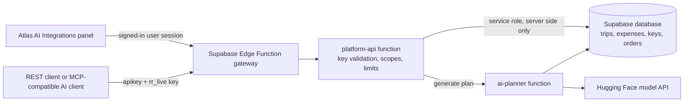
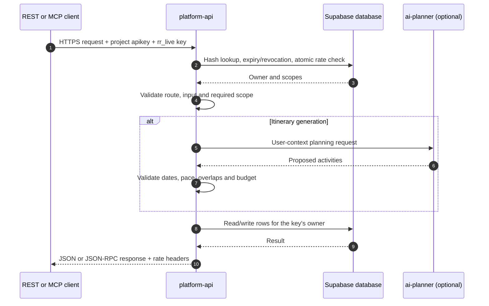

# Atlas AI Platform API

Version **1.0.0** · Updated **2026-10-24**

Atlas AI provides a versioned REST API and a remote [Model Context Protocol
(MCP)](#mcp-server) endpoint for trip data, budget summaries, AI itinerary
generation, and booking request records. Both interfaces use the same scoped,
revocable API keys and owner checks.

> **Booking boundary:** this API can record a booking request for later
> fulfillment. It does not reserve or purchase travel, contact a provider, or
> charge a payment method.

## Contents

- [At a glance](#at-a-glance)
- [Architecture](#architecture)
- [Deploy and configure](#deploy-and-configure)
- [Create and manage API keys](#create-and-manage-api-keys)
- [Authentication and request conventions](#authentication-and-request-conventions)
- [REST API](#rest-api)
- [MCP server](#mcp-server)
- [Limits and quotas](#limits-and-quotas)
- [Errors](#errors)
- [Testing and verification](#testing-and-verification)
- [Troubleshooting](#troubleshooting)
- [Security and production operations](#security-and-production-operations)
- [References](#references)

## At a glance

| Item | Value |
|---|---|
| REST base URL | `https://<project-ref>.supabase.co/functions/v1/platform-api/v1` |
| Health check | `GET https://<project-ref>.supabase.co/functions/v1/platform-api/health` |
| OpenAPI | `GET https://<project-ref>.supabase.co/functions/v1/platform-api/v1/openapi.json` |
| MCP endpoint | `POST https://<project-ref>.supabase.co/functions/v1/platform-api/mcp` |
| API credential | `rr_live_…` key created in Atlas AI → **API & Integrations** |
| Gateway header | `apikey: <project publishable/anon key>` |
| REST format | JSON over HTTPS; `GET` and `POST` |
| MCP transport | Stateless Streamable HTTP over HTTPS |
| API version | `1.0.0`; REST routes are versioned under `/v1` |
| Per-key rate limit | 60 requests per fixed one-minute window |

The API's live machine-readable description is the [OpenAPI
document](#discover-the-openapi-document). The implementation is in
[`supabase/functions/platform-api/index.ts`](../supabase/functions/platform-api/index.ts).

## Architecture

The public API key identifies an Atlas AI account and carries the scopes chosen
when it was created. The function hashes and validates that key, checks the
scope for each operation, and performs owner-scoped database access using its
server-side Supabase service role. The service-role credential is never sent to
the caller.



An API request follows this path. The plan branch is used only by itinerary
generation.



## Deploy and configure

### Requirements

- A Supabase project with the Atlas AI base schema installed.
- Supabase CLI logged in and linked to the intended project, or access to that
  project's SQL Editor and Edge Function settings.
- The `platform-api` function deployed. Deploy `ai-planner` and configure
  `HF_API_KEY` if API consumers will generate itineraries.
- A publishable (or legacy anon) Supabase project key for the `apikey` request
  header. This is the public gateway key; it is not the `rr_live_…` secret.

### Database setup

For a new, empty database, apply [`supabase/master_schema.sql`](../supabase/master_schema.sql)
once, then deploy the functions. For an already initialized Atlas project,
apply the additive platform API migration:
[`supabase/migrations/20261024000001_platform_api.sql`](../supabase/migrations/20261024000001_platform_api.sql).
The API migration adds `integration_api_keys`,
`integration_api_rate_limits`, the atomic rate-limit function, and
`travel_orders`. It assumes the core trip tables and the
`update_updated_at_column()` trigger function already exist.

If using the broader SQL Editor update bundle, see
[`supabase/master_schema_updates.sql`](../supabase/master_schema_updates.sql);
that file also includes other additive app schema changes. Do not apply the
fresh-install master schema to a populated database as a shortcut.

If `supabase db push` reports that a base relation such as `profiles` already
exists, the remote schema and Supabase migration history may be out of sync.
Inspect `supabase migration list --linked` and compare the remote schema with
the relevant migration before changing the migration ledger. A
`supabase migration repair --linked --status applied <version>` command only
records a migration as applied; it does not run its SQL. Use it only after
verifying that every change in that migration is already present. Do not drop
existing user tables or mark a migration applied merely to bypass an error.

### Deploy Edge Functions

From the repository root, log in and link to the intended project. This
repository's Supabase project ref is `dfvyuqxyjlkoovxmtikq`; replace it if
deploying another project.

```sh
supabase login
supabase link --project-ref dfvyuqxyjlkoovxmtikq
supabase functions deploy platform-api --project-ref dfvyuqxyjlkoovxmtikq
```

The `platform-api` function has `verify_jwt = false` in
[`supabase/config.toml`](../supabase/config.toml) so third-party clients can
reach it. It authenticates data requests itself. Do not change that setting to
`true` unless the integration contract is also changed: external clients do
not have a Supabase user JWT.

Itinerary generation delegates to the `ai-planner` function. Deploy it and set
the model provider secret if that capability is needed:

```sh
supabase functions deploy ai-planner --project-ref dfvyuqxyjlkoovxmtikq
supabase secrets set HF_API_KEY="your-hugging-face-token" --project-ref dfvyuqxyjlkoovxmtikq
```

`SUPABASE_URL`, `SUPABASE_ANON_KEY`, and `SUPABASE_SERVICE_ROLE_KEY` are
provided to Supabase Edge Functions. Do not set or publish the service-role key
in a frontend or integration client. See [Supabase Edge Function
secrets](https://supabase.com/docs/guides/functions/secrets).

### Environment values for examples

The following shell variables make the examples below easier to reuse. Keep
`ATLAS_API_KEY` in a local secret store or shell session; do not commit it.

```sh
export SUPABASE_URL="https://dfvyuqxyjlkoovxmtikq.supabase.co"
export SUPABASE_PUBLISHABLE_KEY="<project-publishable-or-anon-key>"
export ATLAS_API_KEY="rr_live_<key-created-in-the-integrations-panel>"
export ATLAS_FUNCTION_URL="$SUPABASE_URL/functions/v1/platform-api"
export ATLAS_API_BASE="$ATLAS_FUNCTION_URL/v1"
```

### Verify the deployment

The health endpoint and OpenAPI document do not require an Atlas API key, but
the Supabase gateway still requires the project `apikey` header.

```sh
curl -i "$ATLAS_FUNCTION_URL/health" \
  -H "apikey: $SUPABASE_PUBLISHABLE_KEY"

curl -i "$ATLAS_FUNCTION_URL/v1/openapi.json" \
  -H "apikey: $SUPABASE_PUBLISHABLE_KEY"
```

Expected health result:

```json
{"status":"ok","version":"1.0.0"}
```

The health response is `503` with `{"status":"not_ready"}` if the function
cannot query `integration_api_keys`; this commonly means the platform API
migration has not been applied to the database used by the function.

## Create and manage API keys

1. Sign in to Atlas AI and open **API & Integrations** (`/integrations`).
2. Create a separate key for each client or environment, such as `staging MCP`
   or `production itinerary service`.
3. Select only the scopes required by that integration and choose an expiry.
4. Copy the complete `rr_live_…` secret when it is shown. The full key is shown
   once; the database stores its SHA-256 hash, not the original secret.
5. Save it in the consuming system's secret manager and revoke it from the
   panel if it is exposed or no longer needed.

An account can have up to **10 active keys**. Expiry can be set from 1 to 365
days or left unset. The panel can list the most recent 50 keys. Revocation
applies to subsequent requests after the key is checked.

### Scopes

| Scope | Allows | Does not allow |
|---|---|---|
| `trips:read` | List accessible trips and read one trip | Read budget totals or create trips |
| `trips:write` | Create a trip for the key owner's account | Edit or delete existing trips |
| `budget:read` | Read expenses and budget totals for an accessible trip | Change expense entries |
| `plans:generate` | Generate and save an itinerary version for an accessible trip | Publish the itinerary or book its activities |
| `orders:read` | List and read the owner's booking request records | Read another account's records |
| `orders:write` | Add a booking request record | Place a provider order or charge a payment method |

The in-app key management call is a dashboard implementation detail. It uses a
signed-in Supabase user session and is not the external integration API. For
third-party calls, create and revoke credentials through the signed-in
Integrations panel.

## Authentication and request conventions

### Required headers

Send both of these headers to REST and MCP data endpoints:

| Header | Value | Purpose |
|---|---|---|
| `apikey` | Supabase publishable/anon project key | Passes the Supabase Edge Function gateway |
| `x-api-key` | Atlas `rr_live_…` key | Identifies the account and grants selected scopes |

As an alternative to `x-api-key`, the Atlas key can be sent as
`Authorization: Bearer rr_live_…`. Do not put the Atlas key in a URL or query
string. Do not send `SUPABASE_SERVICE_ROLE_KEY` to any client.

Public `health` and OpenAPI routes do not require an Atlas key, but still need
the Supabase gateway `apikey`. The key-management UI uses a Supabase user
access token, not an `rr_live_…` API key.

### General behavior

- Use HTTPS and `Content-Type: application/json` for `POST` requests.
- REST methods are `GET` and `POST`; CORS preflight `OPTIONS` is supported.
- REST list endpoints return `{ "data": [...], "pagination": {...} }`.
- Successful REST responses return JSON. Creates generally return `201`;
  idempotent duplicate booking requests return `200` with the original record.
- Error responses have an `error` object with a correlation `request_id`.
- Successful authenticated responses and rate-limit rejections include
  `X-RateLimit-Limit`, `X-RateLimit-Remaining`, and `X-RateLimit-Reset`.
  `X-RateLimit-Reset` is a Unix timestamp in seconds.
- Dates use `YYYY-MM-DD`; currencies use three-letter uppercase codes such as
  `INR` or `USD`.
- REST `POST` JSON requests declaring a body over 1 MB are rejected. Booking `details` has a separate
  20,000-character limit.

## REST API

### Discover the OpenAPI document

```sh
curl "$ATLAS_FUNCTION_URL/v1/openapi.json" \
  -H "apikey: $SUPABASE_PUBLISHABLE_KEY"
```

The response is an OpenAPI 3.1 document. It describes the REST routes, the
gateway and API-key headers, and core request shapes. It is generated by the
deployed function, so use it as the canonical reference for that deployment.

### Endpoint summary

| Method | Path | Required scope | Success | Description |
|---|---|---|---:|---|
| `GET` | `/trips` | `trips:read` | `200` | List trips organized by or shared with the key owner |
| `POST` | `/trips` | `trips:write` | `201` | Create a planning trip owned by the key owner |
| `GET` | `/trips/{trip_id}` | `trips:read` | `200` | Read an accessible trip |
| `GET` | `/trips/{trip_id}/budget` | `budget:read` | `200` | Summarize budget and recorded expenses |
| `POST` | `/trips/{trip_id}/plan` | `plans:generate` | `201` | Generate and save a new unpublished itinerary version |
| `GET` | `/orders` | `orders:read` | `200` | List the owner's booking request records |
| `POST` | `/orders` | `orders:write` | `201` or `200` | Record a booking request; replay can return existing record |
| `GET` | `/orders/{order_id}` | `orders:read` | `200` | Read one of the owner's booking request records |

Every path in this table is relative to `$ATLAS_API_BASE`.

### List trips

`limit` defaults to 50 and is clamped to 1–100. `offset` defaults to 0 and may
not exceed 10,000. `has_more` indicates whether another page is available.

```sh
curl "$ATLAS_API_BASE/trips?limit=20&offset=0" \
  -H "apikey: $SUPABASE_PUBLISHABLE_KEY" \
  -H "x-api-key: $ATLAS_API_KEY"
```

Example response shape:

```json
{
  "data": [
    {
      "id": "<trip-uuid>",
      "name": "Jaipur weekend",
      "destination": "Jaipur",
      "start_date": "2026-11-12",
      "end_date": "2026-11-14",
      "budget_total": 18000,
      "currency": "INR"
    }
  ],
  "pagination": { "limit": 20, "offset": 0, "has_more": false }
}
```

Trip objects include database fields beyond those shown. Treat additional
fields as optional so clients remain compatible with schema additions.

### Create a trip

Required: `name`, `destination`, `start_date`, and `end_date`. Optional:
`country`, `currency`, `budget_total`, and `image_url`. The trip is created in
`planning` status with the API key owner's account as organizer. The date range
is inclusive for itinerary day calculations.

```sh
curl -X POST "$ATLAS_API_BASE/trips" \
  -H "apikey: $SUPABASE_PUBLISHABLE_KEY" \
  -H "x-api-key: $ATLAS_API_KEY" \
  -H "Content-Type: application/json" \
  -d '{
    "name": "Jaipur weekend",
    "destination": "Jaipur",
    "country": "India",
    "start_date": "2026-11-12",
    "end_date": "2026-11-14",
    "budget_total": 18000,
    "currency": "INR"
  }'
```

Validation: name and destination are at most 120 characters; country is at
most 100; `image_url`, if supplied, must be HTTPS and at most 2,048 characters;
budget must be from 0 to 1,000,000,000; currency must be three letters.

### Read a trip

```sh
curl "$ATLAS_API_BASE/trips/$TRIP_ID" \
  -H "apikey: $SUPABASE_PUBLISHABLE_KEY" \
  -H "x-api-key: $ATLAS_API_KEY"
```

A trip is accessible when the key owner organized it or belongs to its trip
membership. A non-existent trip and a trip the owner cannot access both return
`404` to avoid disclosing another user's trip.

### Read a budget summary

```sh
curl "$ATLAS_API_BASE/trips/$TRIP_ID/budget" \
  -H "apikey: $SUPABASE_PUBLISHABLE_KEY" \
  -H "x-api-key: $ATLAS_API_KEY"
```

Example response:

```json
{
  "trip_id": "<trip-uuid>",
  "currency": "INR",
  "budget_total": 18000,
  "spent": 4200,
  "remaining": 13800,
  "over_budget": false,
  "expenses_count": 3,
  "spent_by_currency": { "INR": 4200 },
  "category_totals_by_currency": {
    "INR": { "food": 1200, "transport": 3000 }
  }
}
```

The endpoint reads `group_expenses`; it does not include pending booking
requests or estimate unrecorded costs. If expenses use another currency, the
summary keeps those totals separate and does not convert exchange rates.

### Generate and save an itinerary

Set a positive budget and `country: "India"` on the trip. The trip currency
must be INR and its inclusive duration must be 1–14 days. `travelers` is
optional (defaults to the trip membership count, with a minimum of one), and
must be 1–50 when supplied. `interests` accepts up to 12 strings of up to 40
characters; `trip_type` defaults to `leisure` and is truncated to 40
characters.

```sh
curl -X POST "$ATLAS_API_BASE/trips/$TRIP_ID/plan" \
  -H "apikey: $SUPABASE_PUBLISHABLE_KEY" \
  -H "x-api-key: $ATLAS_API_KEY" \
  -H "Content-Type: application/json" \
  -d '{
    "travelers": 2,
    "interests": ["architecture", "local food", "markets"],
    "trip_type": "weekend cultural trip"
  }'
```

The response contains `trip_id`, a new `itinerary` row, `activities`,
`total_cost`, `currency`, an optional `explanation`, and a review reminder. The
itinerary is saved as unpublished. Before returning success, the API checks
that there is at least one activity, no more than 80 total, no more than six
per day, no overlapping activities, no activity longer than 14 hours, and a
total activity cost no more than 102% of the trip budget. This operation can
take tens of seconds; clients should configure a suitable timeout and handle
retryable planner failures.

The planner uses the configured `HF_API_KEY`. If it is missing or the model
provider is unavailable, ordinary read/write endpoints can still work, but
itinerary generation will fail.

### Record a booking request

Required: `order_type` and `item_name`. Allowed types: `flight`, `hotel`,
`activity`, `transport`, `package`, and `other`. Optional fields are
`trip_id`, `provider`, `quoted_amount`, `currency`, and a JSON object named
`details`.

```sh
curl -X POST "$ATLAS_API_BASE/orders" \
  -H "apikey: $SUPABASE_PUBLISHABLE_KEY" \
  -H "x-api-key: $ATLAS_API_KEY" \
  -H "Content-Type: application/json" \
  -H "Idempotency-Key: jaipur-hotel-2026-11-v1" \
  -d '{
    "order_type": "hotel",
    "item_name": "Two nights near Hawa Mahal",
    "trip_id": "<trip-uuid>",
    "provider": "Example hotel partner",
    "quoted_amount": 6800,
    "currency": "INR",
    "details": { "check_in": "2026-11-12", "nights": 2 }
  }'
```

The first accepted request returns `201`; reusing the same idempotency key for
the same account returns the previously stored record with `200`. The key may
also be supplied as `idempotency_key` in the JSON body. It can contain letters,
numbers, `.`, `_`, `:`, or `-`, up to 128 characters. The database uniqueness
scope is the user account, not the individual API key, so use a unique value
for each logical request across all integrations under that account.

`details` is limited to 20,000 serialized characters and must not contain
payment card, bank account, password, secret, token, or authorization data.
Sensitive field names are rejected recursively. The API stores the request
with status `requested` and returns `fulfillment: "request_recorded_only"` and
a notice that no booking or payment occurred. Reusing an idempotency key with a
different payload returns the original request; clients should only reuse a
key when retrying the same logical operation.

### List and read booking requests

```sh
curl "$ATLAS_API_BASE/orders?limit=20&offset=0" \
  -H "apikey: $SUPABASE_PUBLISHABLE_KEY" \
  -H "x-api-key: $ATLAS_API_KEY"

curl "$ATLAS_API_BASE/orders/$ORDER_ID" \
  -H "apikey: $SUPABASE_PUBLISHABLE_KEY" \
  -H "x-api-key: $ATLAS_API_KEY"
```

Pagination has the same `limit` and `offset` constraints as `GET /trips`.
Order records are visible only to the account that created them.

## MCP server

### Connect an MCP client

Configure a remote **Streamable HTTP** MCP server with:

| Setting | Value |
|---|---|
| URL | `https://<project-ref>.supabase.co/functions/v1/platform-api/mcp` |
| Header | `apikey: <project publishable/anon key>` |
| Header | `x-api-key: <Atlas rr_live key>` |
| Transport | Streamable HTTP over HTTPS |

Create a key with only the scopes needed for that AI client. Some MCP clients
can connect directly to remote Streamable HTTP servers. A client that only
supports local stdio servers needs its own compatible HTTP-to-stdio bridge.
Client configuration fields differ, so use the equivalent URL, transport, and
header fields in the client you run.

The endpoint supports the stateless MCP `2026-07-28` discovery flow and the
legacy `initialize` handshake versions `2025-11-25`, `2025-06-18`, `2025-03-26`,
and `2024-11-05`. For the `2026-07-28` flow, the protocol version must be in
both the `MCP-Protocol-Version` header and request metadata. The `Mcp-Method`
header must match the JSON-RPC method, and `Mcp-Name` must match the requested
tool name on `tools/call`.

### Discover capabilities

```sh
curl -X POST "$ATLAS_FUNCTION_URL/mcp" \
  -H "apikey: $SUPABASE_PUBLISHABLE_KEY" \
  -H "x-api-key: $ATLAS_API_KEY" \
  -H "Content-Type: application/json" \
  -H "MCP-Protocol-Version: 2026-07-28" \
  -H "Mcp-Method: server/discover" \
  -d '{
    "jsonrpc": "2.0",
    "id": 1,
    "method": "server/discover",
    "params": { "_meta": { "io.modelcontextprotocol/protocolVersion": "2026-07-28" } }
  }'
```

Discovery returns supported versions, server name/version, and a private
60-second cache hint. Then list tools the credential is authorized to use:

```sh
curl -X POST "$ATLAS_FUNCTION_URL/mcp" \
  -H "apikey: $SUPABASE_PUBLISHABLE_KEY" \
  -H "x-api-key: $ATLAS_API_KEY" \
  -H "Content-Type: application/json" \
  -H "MCP-Protocol-Version: 2026-07-28" \
  -H "Mcp-Method: tools/list" \
  -d '{
    "jsonrpc": "2.0",
    "id": 2,
    "method": "tools/list",
    "params": { "_meta": { "io.modelcontextprotocol/protocolVersion": "2026-07-28" } }
  }'
```

### Call an MCP tool

This call reads a trip. For the modern protocol, the three MCP headers and
metadata must agree with the request:

```sh
curl -X POST "$ATLAS_FUNCTION_URL/mcp" \
  -H "apikey: $SUPABASE_PUBLISHABLE_KEY" \
  -H "x-api-key: $ATLAS_API_KEY" \
  -H "Content-Type: application/json" \
  -H "MCP-Protocol-Version: 2026-07-28" \
  -H "Mcp-Method: tools/call" \
  -H "Mcp-Name: get_trip" \
  -d '{
    "jsonrpc": "2.0",
    "id": 3,
    "method": "tools/call",
    "params": {
      "name": "get_trip",
      "arguments": { "trip_id": "<trip-uuid>" },
      "_meta": { "io.modelcontextprotocol/protocolVersion": "2026-07-28" }
    }
  }'
```

Successful tool results include `content` (JSON serialized as text) and
`structuredContent`. Tool execution failures are returned as a JSON-RPC success
envelope containing `result.isError: true` and a text message; an MCP client
must inspect that flag as well as the HTTP status.

### Available tools

| Tool | Scope | Arguments | Effect |
|---|---|---|---|
| `list_trips` | `trips:read` | None | List accessible trips (default page size) |
| `get_trip` | `trips:read` | `trip_id` | Read an accessible trip |
| `create_trip` | `trips:write` | Trip creation fields | Create a planning trip |
| `get_trip_budget` | `budget:read` | `trip_id` | Read expense and budget summary |
| `generate_trip_plan` | `plans:generate` | `trip_id`, optional travelers/interests/trip type | Generate and save an unpublished itinerary |
| `create_booking_request` | `orders:write` | Order fields; optional `idempotency_key` | Save a request record only |
| `list_booking_requests` | `orders:read` | None | List the owner's requests (default page size) |

The server filters `tools/list` by key scopes and checks the required scope
again for each call. Tool discovery is convenience, not authorization. The
MCP list tools currently use default pagination; use the REST list endpoints
when explicit `limit` or `offset` is needed.

## Limits and quotas

| Limit | Value | Applies to |
|---|---:|---|
| Active API keys | 10 per account | Key creation through the Integrations panel |
| Key expiry | 1–365 days, or no expiry | Key creation |
| REST/MCP rate | 60 requests per fixed one-minute window per API key | Authenticated API calls |
| List page size | Default 50; maximum 100 | `GET /trips`, `GET /orders` |
| List offset | Maximum 10,000 | `GET /trips`, `GET /orders` |
| REST/MCP declared body size | 1 MB | `POST` request bodies |
| Booking `details` | 20,000 serialized characters | `POST /orders`, `create_booking_request` |
| Trip name/destination | 120 characters each | `POST /trips` |
| Trip country | 100 characters | `POST /trips` |
| Trip budget or quoted amount | 0–1,000,000,000 | Trip/order writes |
| Itinerary duration | 1–14 inclusive days | `POST /trips/{id}/plan` |
| Itinerary travelers | 1–50 | Plan generation |
| Plan interests | At most 12; 40 characters each | Plan generation |
| Generated activities | 1–80 total, max 6/day | Plan generation validation |
| Generated activity duration | At most 14 hours | Plan generation validation |
| Generated itinerary cost | At most 102% of trip budget | Plan generation validation |
| Planner request timeout | 50 seconds at the platform API | Plan generation |

The request counter is an atomic database check keyed by API key and minute.
Read `X-RateLimit-Remaining`; when it reaches zero, wait until the Unix time in
`X-RateLimit-Reset` and retry with exponential backoff and jitter. A request
that exceeds the limit returns `429 rate_limit_exceeded`.

Supabase also enforces Edge Function runtime, payload, concurrency, and plan
quotas outside the limits above. Those values depend on the Supabase plan and
can change; consult the current [Edge Functions
limits](https://supabase.com/docs/guides/functions/limits) page. Model provider
quotas and latency apply separately to itinerary generation.

## Errors

REST errors use this shape:

```json
{
  "error": {
    "code": "insufficient_scope",
    "message": "This key needs the 'trips:read' scope.",
    "request_id": "<request-uuid>"
  }
}
```

| HTTP status | Example code | Meaning / next step |
|---:|---|---|
| `400` | `invalid_request`, `sensitive_data_rejected` | Correct the JSON, date, identifier, or field constraints |
| `401` | `unauthorized` | Check `x-api-key`/Bearer key, expiry, revocation, and gateway `apikey` |
| `403` | `insufficient_scope` | Create a key with the named scope |
| `404` | `not_found` | Route or owner-accessible resource was not found |
| `405` | `method_not_allowed` | Use a supported method; MCP uses POST |
| `409` | `key_limit_reached` | Revoke an unused key before creating another |
| `413` | `payload_too_large` | Reduce the request body or booking details |
| `422` | Plan-specific code such as `unsupported_currency` | Adjust trip settings or retry with a valid planning input |
| `429` | `rate_limit_exceeded` | Wait until `X-RateLimit-Reset`; back off before retrying |
| `502` | `planner_unavailable`, `invalid_plan` | Retry later; check planner logs and model configuration |
| `503` | `service_unavailable`, `planner_unavailable` | Check schema, database connectivity, or required function secrets |
| `500` | `internal_error` | Use `request_id` to correlate with Edge Function logs |

Error responses can be non-2xx at the HTTP layer. Clients using Supabase's
`functions.invoke()` should inspect the returned error context/response body to
see the API's `error.code` and `request_id`; the generic message “Edge Function
returned a non-2xx status code” is not the underlying API error.

MCP protocol errors use JSON-RPC error envelopes with JSON-RPC codes. Tool
execution errors instead use `result.isError: true`, as described above.

## Testing and verification

These are operator smoke checks to run against a development or staging
project. Use a disposable test account and trips before exercising writes.

### 1. Check health and OpenAPI

Run the [deployment checks](#verify-the-deployment). Confirm health returns
`200` and the OpenAPI request returns `200` with `openapi: "3.1.0"`.

### 2. Check authentication and scopes

Try a data endpoint with no Atlas key and expect `401`. Then use a valid key
without `trips:read` and expect `403` with `insufficient_scope`. Finally call
`GET /trips` with a key containing `trips:read` and expect `200`. These checks
confirm that gateway access and application-level authorization both work.

### 3. Exercise owner isolation

With two test accounts, create a trip under account A. Confirm A can read it.
With a key belonging to account B, confirm `GET /trips/{trip_id}` returns
`404`. Confirm order records created by A do not appear in B's `GET /orders`.

### 4. Exercise writes and replay safety

Create one disposable trip. Read its budget. If the trip meets planner
requirements and `HF_API_KEY` is configured, generate one test plan and verify
that the response is unpublished and includes activities. Submit an order
request twice with the same `Idempotency-Key`; confirm the first call returns
`201`, the replay returns `200`, and both identify the same order record.

### 5. Check throttling

In a non-production environment, make more than 60 authenticated requests with
one test key in the same minute. Confirm the request after the limit returns
`429`, and that the rate-limit headers indicate when to retry. Avoid running
this check against a shared production key.

### 6. Inspect deployed function logs

```sh
supabase functions logs platform-api --project-ref dfvyuqxyjlkoovxmtikq
supabase functions logs ai-planner --project-ref dfvyuqxyjlkoovxmtikq
```

Do not log or paste raw API keys. For application errors, retain the response
`request_id`, endpoint, timestamp, and HTTP status when investigating.

## Troubleshooting

| Symptom | Likely cause | Checks |
|---|---|---|
| `Failed to send a request to the Edge Function` | Network, gateway, or CORS request failure before a readable API response | Check browser Network panel, function URL, project `apikey`, deployment status, and browser console |
| `Edge Function returned a non-2xx status code` | The function responded with an API error such as `401`, `403`, `429`, or `503` | Inspect the response body for `error.code` and `request_id`; check function logs |
| Health returns `404` | Function name/path mismatch or stale deployment | Confirm URL contains `/functions/v1/platform-api/health`; redeploy `platform-api` |
| Health returns `503 not_ready` | API tables are absent or the function cannot query them | Apply and verify `20261024000001_platform_api.sql` on the same project |
| Data call returns `401` | Missing/wrong `rr_live_…` key, revoked/expired key, or missing project `apikey` | Confirm both headers and key status in the Integrations panel |
| Data call returns `403 insufficient_scope` | Key lacks the endpoint's required scope | Add only the required scope to a replacement key, then rotate the integration |
| Plan generation returns `503` or `502` | Planner not deployed, `HF_API_KEY` missing, provider failure, or timeout | Check `ai-planner` deployment, secret configuration, provider quota, and logs |
| `supabase db push` says `profiles` already exists | Remote schema was installed outside the current migration history | Inspect the remote schema and `supabase migration list --linked`; reconcile history carefully |
| MCP reports protocol/header mismatch | Modern request headers and body metadata do not agree | For `2026-07-28`, align protocol version, method, and tool-name headers with the JSON-RPC body |

The function normalizes both the public gateway path
`/functions/v1/platform-api/...` and the Edge Runtime's internal
`/platform-api/...` path. If the deployed function predates this routing logic,
deploy the current `platform-api` function and rerun the health check.

## Security and production operations

- Issue one key per integration/environment, give it the smallest useful
  scopes, and set an expiry. Rotate by creating a replacement, updating the
  consumer, verifying it, then revoking the old key.
- Store `rr_live_…` in a server-side secret manager. Do not embed it in a
  browser bundle, public repository, URL, analytics event, screenshot, or
  client-side MCP configuration shared with untrusted users.
- The Supabase publishable/anon `apikey` is designed for client routing; the
  Atlas `rr_live_…` credential is the scoped secret. Neither one is the
  service-role key.
- Keep `SUPABASE_SERVICE_ROLE_KEY` and `HF_API_KEY` in Edge Function secrets.
  The platform function uses service-role access internally and enforces the
  API key owner's access checks itself.
- Every trip read/write is checked against organizer or membership ownership;
  order requests are filtered by account owner. Use separate test accounts to
  verify this boundary before production rollout.
- AI-generated itineraries are model output. The API validates basic schedule
  and budget constraints, but a person should review the itinerary before
  publishing or acting on it.
- `POST /orders` and `create_booking_request` only create a `requested` record.
  Provider search, availability checks, confirmation, cancellation workflows,
  payment handling, and refunds are outside this API's current contract.
- Enable production email confirmation and secure account recovery in Supabase
  Auth. Rotate any unrelated provider credentials that may have been exposed
  in repository history; they are separate from the hashed Atlas API key store.
- The Edge Function currently allows cross-origin requests. CORS is a browser
  transport rule, not access control; API keys and server-side ownership checks
  remain required for data endpoints.

## References

- [Supabase Edge Functions](https://supabase.com/docs/guides/functions) — deployment and runtime overview.
- [Supabase Edge Function limits](https://supabase.com/docs/guides/functions/limits) — plan-specific execution and resource limits.
- [Supabase Edge Function secrets](https://supabase.com/docs/guides/functions/secrets) — server-side environment secrets.
- [Supabase database migrations](https://supabase.com/docs/guides/deployment/database-migrations) — migration workflow and remote history.
- [Supabase API keys](https://supabase.com/docs/guides/api/api-keys) — publishable and secret project key concepts.
- [OpenAPI Specification 3.1](https://spec.openapis.org/oas/v3.1.2.html) — REST API description format.
- [MCP 2026-07-28 release notes](https://blog.modelcontextprotocol.io/posts/2026-07-28/) — stateless discovery and protocol changes.
- [MCP TypeScript SDK v2 protocol versions](https://ts.sdk.modelcontextprotocol.io/v2/protocol-versions) — MCP version and compatibility guidance.
- [Hugging Face Inference Providers](https://huggingface.co/docs/inference-providers/index) — provider configuration used by the itinerary planner.
