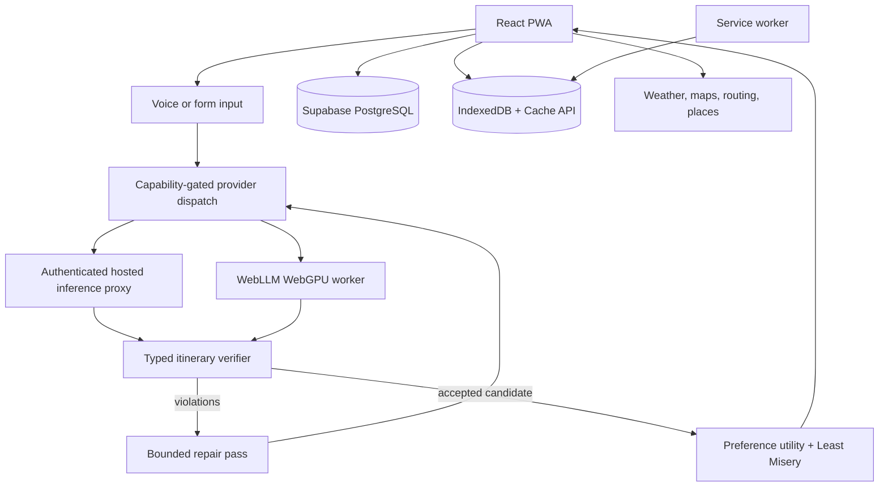

# Radiator Routes: A Connectivity-Resilient, Constraint-Checked Group Travel Planner

**Manuscript status:** Structured draft; not yet submitted  
**Version:** 0.1  
**Date:** 24 October 2026  
**Repository:** <https://github.com/HarshTambade/Radiator-Routes>  
**Author:** Harsh Tambade  
**Artifact status:** The implementation is public. The empirical evaluation described
below is a protocol, not a completed result.

> **Publication integrity notice:** This document is designed to become a research
> paper, but it is not evidence that the proposed mechanisms improve user outcomes.
> Replace every `[TO MEASURE]` field with collected data before submission. Do not
> convert a passing unit test into a claim of real-world effectiveness.

## Abstract

Group travel planning combines conflicting preferences, a shared budget, temporal and
geospatial constraints, uncertain external data, and intermittent connectivity. Large
language models can produce fluent itineraries, but syntactic validity does not imply
physical feasibility. Radiator Routes is a browser-based progressive web application
that explores a systems response to this problem.

The system has three research-relevant mechanisms. First, it places a deterministic,
client-side itinerary verifier between model output and user-visible plan state. The
verifier checks budget arithmetic, temporal consistency, travel feasibility, coordinate
validity, daily pace, and opening-hour evidence. Failed plans can be sent through one
targeted repair pass, and a replacement is accepted only when it reduces the verified
violation count. Second, it computes a group recommendation using a Least Misery
aggregation over member preference utilities rather than displaying a score supplied by
the language model. Third, it provides a capability-gated hosted/on-device architecture:
hosted inference is available through an authenticated proxy, while WebLLM can execute
selected models locally in a WebGPU-capable browser. IndexedDB persistence, service-worker
caching, and durable mutation replay support use under intermittent connectivity.

The artifact demonstrates implementation and testability, not yet effectiveness.
The central empirical question is whether external verification and repair improve
constraint satisfaction for small on-device models without making interaction
unacceptably slow, and whether computed group scores correlate with perceived fairness.
This manuscript specifies the system, formalizes the mechanisms, defines a reproducible
evaluation, states limitations, and separates engineering evidence from research claims.

**Keywords:** group recommendation; itinerary planning; LLM verification; constraint
checking; offline-first PWA; on-device inference; WebGPU; fairness; travel technology

## 1. Introduction

Planning a group trip is a constrained decision problem presented to users as a social
coordination problem. Travellers must negotiate different interests and budgets while
respecting opening hours, travel times, dates, weather, and the availability of
information. Existing travel products frequently optimise discovery or booking rather
than making the compromise visible and resilient when connectivity fails.

Language models make conversational planning accessible, but they introduce a reliability
problem: a response can be grammatically valid, persuasive, and internally contradictory.
For example, a plan can place two distant attractions thirty minutes apart, schedule a
weekly market on its closed day, or declare a total that does not equal the listed costs.
A JSON schema catches malformed structure; it cannot establish that a schedule is
physically plausible.

Radiator Routes investigates whether reliability can be improved by composing:

1. natural-language itinerary generation;
2. deterministic, typed semantic checks;
3. one bounded repair attempt;
4. preference-based group aggregation; and
5. an offline-capable browser architecture.

The contribution is therefore a **system composition and evaluation opportunity**, not a
claim that a language model solves the Tourist Trip Design Problem or that the application
finds an optimal itinerary.

### 1.1 Research questions

**RQ1 — Verification:** Compared with direct rendering, does deterministic verification
increase the proportion of generated itineraries that satisfy executable constraints?

**RQ2 — Repair:** When verification identifies a violation, does one targeted repair pass
reduce violations without causing unacceptable latency, cost, or new errors?

**RQ3 — Local inference:** Under comparable prompts and constraints, how does on-device
inference compare with hosted inference for validity, usefulness, latency, memory, and
privacy?

**RQ4 — Group fairness:** Does the computed Least Misery score correlate with group
members' perceived fairness and acceptance of a selected plan?

**RQ5 — Resilience:** Which planning and editing capabilities remain available during
network loss, and what is the recovery behavior when connectivity returns?

### 1.2 Contributions

The paper should claim only the following artifact-level contributions:

- an implemented reference architecture for hosted and browser-local itinerary
  generation behind a shared provider interface;
- a typed verifier for itinerary-level constraints and a bounded repair policy;
- an explicit, computed group utility and Least Misery aggregation;
- an offline-first persistence and synchronization path for saved trips and selected
  activity edits;
- a reproducible evaluation protocol that can test these mechanisms separately.

The paper should not claim optimality, general safety, clinical reliability, universal
offline operation, or novelty over all travel-planning patents.

## 2. System requirements and design principles

### 2.1 Functional requirements

The system accepts trip destination, dates, budget, party size, interests, pace, and
optional member preferences. It produces a structured itinerary containing activities,
time windows, locations, costs, and explanatory text. It supports editing, collaboration,
map display, weather-aware re-planning, and export.

### 2.2 Non-functional requirements

| Requirement | Design response |
|---|---|
| Do not render obviously infeasible model output as final state | Verify before applying the plan |
| Make group trade-offs inspectable | Store member preferences and expose per-member utility/regret |
| Continue reading saved plans without a network | IndexedDB plus service-worker app shell |
| Preserve selected offline edits | Durable mutation queue with sequence ordering and conflict detection |
| Do not require a hosted key for private experimentation | Optional WebLLM/WebGPU provider |
| Keep provider failure explicit | Typed errors, capability checks, and user-visible status |
| Keep heavy features out of the initial bundle | Lazy route, map, PDF, and on-device model chunks |

### 2.3 Design principles

**External verification over self-assertion.** The model proposes; deterministic code
checks. A model-generated field is not treated as a measurement merely because it has a
numeric type.

**Evidence-aware severity.** Opening hours from an authoritative source can be a
blocking violation; model-supplied hours are treated as warnings because their provenance
is weaker.

**Bounded recovery.** Repair is attempted once. The original plan is retained until a
replacement is generated and verified, preventing a failed repair from silently
destroying usable state.

**Graceful degradation.** Missing optional providers disable the affected capability
and do not make saved, local data unusable.

## 3. Architecture



### 3.1 Frontend and route boundaries

React and TypeScript provide the UI and type-level contracts. React Router protects
authenticated routes through `ProtectedLayout`. Pages are lazy-loaded so the landing
route does not eagerly download itinerary, map, PDF, or community features.

### 3.2 Provider dispatch

`src/lib/aiProvider.ts` and `src/services/gemini.ts` present a common call surface to
planning, chat, memory, and re-planning code. The hosted path uses an authenticated
Supabase Edge Function. The local path uses WebLLM in a worker when WebGPU is available.
The system performs both API presence and adapter availability checks; the existence of
`navigator.gpu` alone is not sufficient.

### 3.3 Verification and repair

The generated object is parsed into the application itinerary shape and passed to
`verifyItinerary()`. The current checks include:

- empty itinerary;
- malformed or reversed timestamps;
- overlapping activities;
- implausible activity duration;
- daily pace;
- total budget;
- per-activity cost sum;
- invalid coordinates;
- coordinates outside the destination's plausible region;
- travel distance versus available time;
- closed weekday;
- activity outside known opening hours.

The verifier returns typed issues with codes and severity. `generateWithRepair()` can
construct a targeted repair instruction and make one additional generation attempt.
The replacement is accepted only if verification improves according to the configured
violation comparison. This is a recovery policy, not a proof of correctness.

### 3.4 Group preference aggregation

For group members \(m_i\) and candidate plans \(p\), the system computes:

\[
u_i(p) = \text{normalised utility from category weights, review scores, and budget fit}
\]

\[
r_i(p) = \max_{q \in P} u_i(q) - u_i(p)
\]

\[
R(p) = \max_i r_i(p), \qquad p^* = \arg\min_{p \in P} R(p)
\]

This is a Least Misery aggregation. It is transparent and reproducible, but it is not
an objective measure of human satisfaction. Empty preferences are reported as “not
scored” rather than silently filled with defaults.

### 3.5 Offline data path

Before a trip, the app can persist trip data, cache map tiles around a destination, and
optionally download a local model. During connectivity loss, the app serves the shell,
reads saved trips from IndexedDB, renders cached tiles, and can use local inference when
the model is already available. Selected activity mutations are queued with a monotonic
sequence number and replayed on reconnect. An `updated_at` expectation detects a
concurrent server edit and surfaces a conflict instead of silently overwriting it.

This is **partial offline support**, not universal offline operation. Authentication,
realtime collaboration, new remote route queries, and several write paths still require
connectivity.

## 4. Implementation

### 4.1 Reproducible artifact

```text
src/lib/itineraryVerifier.ts  deterministic checks
src/lib/planRepair.ts         bounded repair and comparison
src/lib/groupRegret.ts        utility and Least Misery aggregation
src/lib/aiProvider.ts         provider capabilities and dispatch
src/services/webllm.ts        local model lifecycle
src/services/webllmWorker.ts  non-blocking local inference
src/services/offlineTrip.ts   IndexedDB trip persistence and tile prefetch
src/lib/offlineMutation.ts    durable mutation queue and replay
src/hooks/useOfflineSync.ts   reconnect-driven synchronization
supabase/                     schema, policies, and edge functions
src/test/                     unit and integration-oriented tests
```

### 4.2 Data and privacy boundaries

Hosted prompts leave the browser and are sent to the configured provider through the
server-side proxy. Local prompts remain on the device after model weights are cached.
Supabase stores account, trip, activity, and collaboration data subject to the deployed
schema and Row-Level Security policies. The application must not be described as
anonymous, private, or compliant with a particular privacy regulation without a separate
deployment and legal assessment.

### 4.3 Failure handling

Provider errors are normalised into categories such as missing configuration, rate
limit, authentication failure, timeout, and unavailable capability. The UI should tell
the user whether to retry, switch provider, reconnect, or continue with saved data.
The verifier does not treat an unknown external fact as proof that a place is closed.

## 5. Evaluation methodology

This section is a protocol to execute, not a result.

### 5.1 Experimental factors

| Factor | Levels |
|---|---|
| Provider | hosted; local 1B/3B; local 7B/8B where hardware permits |
| Verification | direct render; verifier only; verifier plus repair |
| Trip complexity | low, medium, high constraint density |
| Connectivity | continuous; interrupted during read; interrupted during edit |
| Group size | 2, 4, 6, 8 members |

### 5.2 Dataset

Construct a versioned benchmark of synthetic and human-authored trip specifications.
Each item must include destination, date range, budget, group preferences, mandatory
activities, opening-hour records with provenance, and a gold set of executable
constraints. Store prompts and expected constraint labels separately from generated
outputs. Do not use private traveller data without consent and de-identification.

Recommended minimum pilot:

- 100 trip specifications;
- 3 providers or model configurations;
- 3 generation conditions;
- 3 independent seeds or repeated runs per item.

These numbers are planning targets, not evidence of statistical power.

### 5.3 Metrics

**Validity**

- hard-violation rate per itinerary;
- mean and median violations per itinerary;
- cost arithmetic accuracy;
- temporal-overlap rate;
- travel-feasibility rate;
- opening-hours accuracy by provenance.

**Repair**

- fraction of failed plans repaired to zero hard violations;
- mean violation reduction;
- new-violation rate after repair;
- repair latency and token cost;
- acceptance rate under the strict comparison policy.

**Group decision quality**

- Least Misery score;
- max and mean member regret;
- pairwise preference agreement;
- perceived fairness from post-task Likert responses;
- plan acceptance or revision rate.

**Systems**

- time to first response;
- time to complete itinerary;
- tokens per second;
- model download size;
- peak memory/GPU memory;
- offline read success;
- offline mutation replay success;
- conflict detection precision and recall.

**Privacy and resilience**

- prompt egress count in local mode;
- functionality available after controlled network loss;
- recovery time after reconnect;
- data retained after logout.

### 5.4 Baselines and ablations

At minimum compare:

1. direct model output rendered without verification;
2. model output with verifier but no repair;
3. model output with verifier and one repair;
4. hosted provider versus local provider;
5. computed Least Misery selection versus random candidate and single-plan choice.

An ablation that removes one verifier check at a time will show which checks contribute
to detected failures. An ablation that replaces member preferences with defaults will
test whether the fairness result is actually input-sensitive.

### 5.5 Statistical analysis

Report paired results per trip specification. Use bootstrap confidence intervals for
violation-rate differences, and a mixed-effects or repeated-measures model when repeated
generations share the same trip item. For ordinal fairness ratings, report effect sizes
and uncertainty rather than only mean scores. Pre-register primary outcomes and stopping
rules before collecting confirmatory data.

### 5.6 Human evaluation

Recruit adult participants who regularly plan group trips. Obtain informed consent,
avoid collecting unnecessary location or identity data, and disclose that generated
routes and safety information may be wrong. Each group should review matched plans under
counterbalanced conditions. Ask members to rate fairness, usefulness, confidence, and
willingness to use the plan. Do not present a model output as safety-critical advice
without independent verification.

## 6. Results and evidence ledger

The following are the claims currently supportable from the repository. Replace the
unknown cells only after running the corresponding experiment.

| Claim | Current evidence | Status |
|---|---|---|
| Verifier is implemented | Source and unit tests | Supported at code level |
| Repair is wired into planning paths | Source inspection and tests | Supported at code level |
| Least Misery is computed from member input | Source and tests | Supported at code level |
| Saved trips can be read offline | IndexedDB/service-worker design | Requires device validation |
| Selected activity edits replay after reconnect | Queue tests and implementation | Requires live integration validation |
| Local inference produces useful itineraries | No benchmark yet | Unknown |
| Verification improves plan validity | No comparative experiment yet | Unknown |
| Repair improves outcomes | No comparative experiment yet | Unknown |
| Least Misery predicts perceived fairness | No human study yet | Unknown |
| The composition is patentable | Requires professional legal search | Unknown |

## 7. Threats to validity and limitations

The verifier encodes heuristics, not a complete route solver. A plausible travel-speed
assumption can reject a feasible plan or accept an infeasible one. Opening-hour checks
depend on data provenance and freshness. External APIs can change, rate-limit, or return
stale information. Local model results vary with browser, GPU, quantisation, context
length, and thermal state. Hosted and local models are not directly comparable if their
prompt templates or token limits differ.

Least Misery depends on preference elicitation quality. A member can misstate a preference,
fail to complete the form, or value a factor not represented by the utility function.
Minimising maximum regret may be fair in one group's view and undesirable in another.
The application is not a booking engine, emergency service, accessibility certification,
or guarantee of safe travel.

The public repository creates temporal leakage for patent strategy: publication can
affect novelty in jurisdictions with absolute novelty requirements. Consult counsel
before adding new technical disclosures.

## 8. Reproducibility checklist

Before submitting a paper, archive:

- exact commit SHA;
- `package-lock.json`;
- Node, browser, OS, and GPU versions;
- model IDs, quantisation, context length, and prompt templates;
- dataset release and licence;
- random seeds;
- provider configuration without secrets;
- raw outputs and verifier reports with personal data removed;
- analysis scripts and statistical environment;
- screenshots or recordings only with participant consent;
- build, test, and evaluation logs.

Run the repository baseline:

```sh
npm ci
npm run verify
```

Record the output instead of copying historical numbers from older reports. The project
uses `npm` and declares its required Node engine in `package.json`.

## 9. Conclusion

Radiator Routes is a credible artifact for studying reliability and resilience around
language-model itinerary generation. Its strongest research value is the explicit
separation between a fluent proposal and a verified plan, combined with a browser-local
execution path. Its strongest current limitation is the absence of outcome measurements.
The next scientific step is therefore not another feature claim: it is a controlled
evaluation of validity, repair, fairness, latency, privacy, and offline recovery.

## References and companion sources

Use the curated bibliography and prior-art notes in [`RESEARCH.md`](./RESEARCH.md).
Use [`REPORT.md`](./REPORT.md) for the implementation narrative and engineering audit.
Use [`PATENT_DISCLOSURE.md`](./PATENT_DISCLOSURE.md) only as an inventor-to-counsel
technical brief, not as a legal opinion or filing-ready application.
